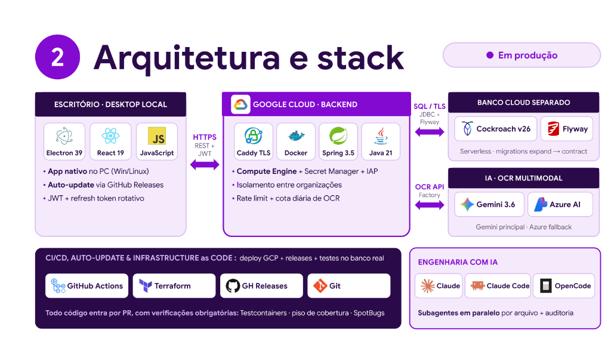
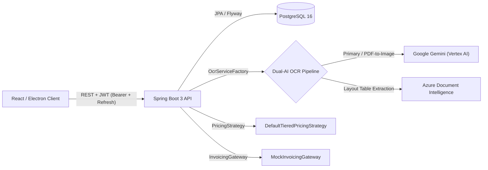
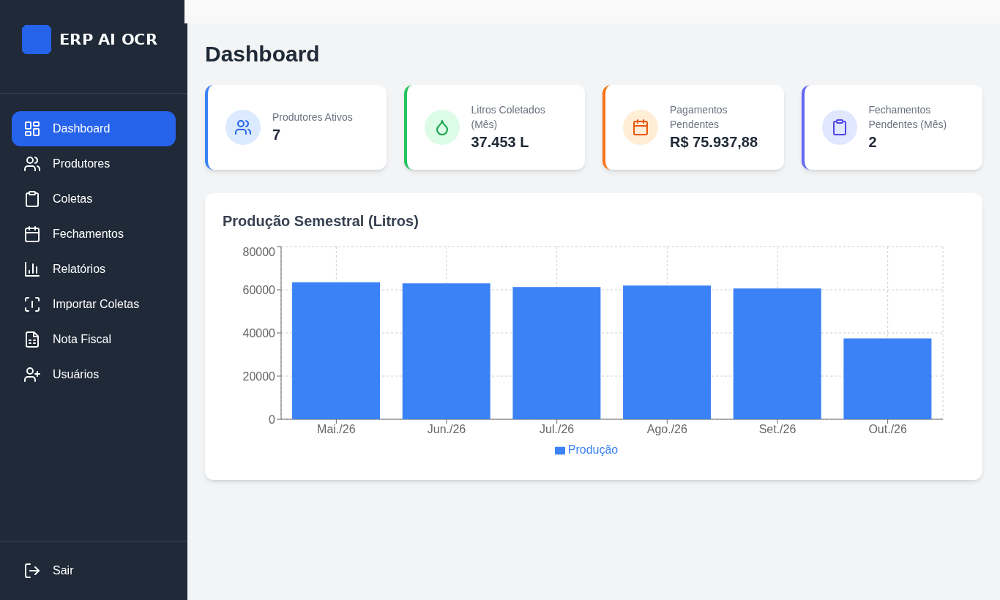
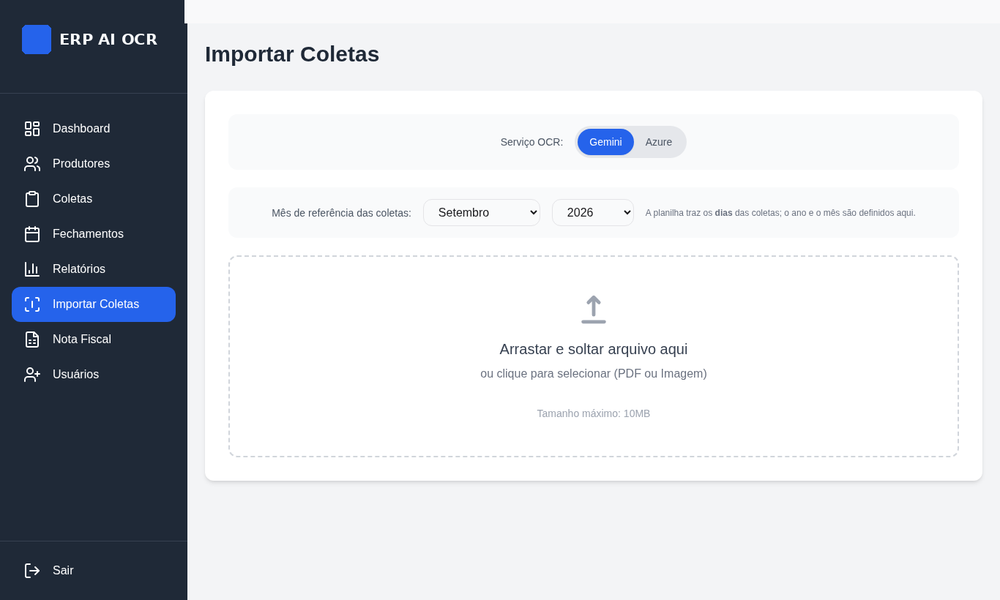
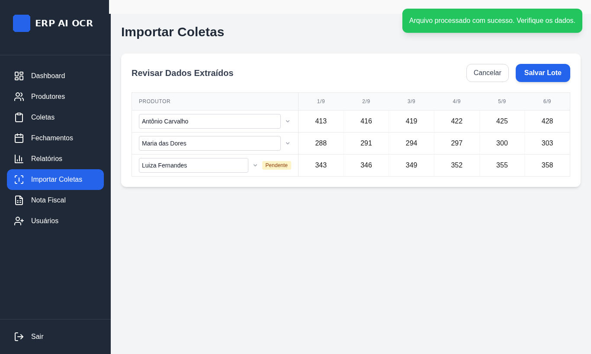
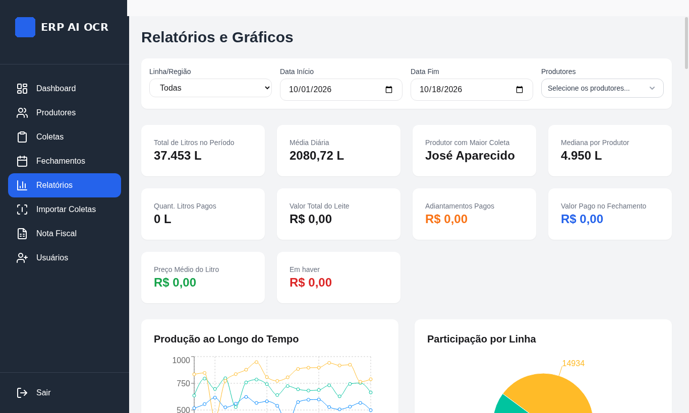

# Supply & Production ERP with Dual-AI OCR

> **Open-Source Starter Edition** — This repository is the sanitized, open-source version of a real-world production ERP system. All client branding, proprietary pricing/fiscal formulas, real data, and cloud credentials have been removed or abstracted into clean, pluggable interfaces (`PricingStrategy` / `SettlementRule` and `InvoicingGateway`) so you can run, study, and extend the core architecture out of the box.

---

## Problem & Overview

Many small-to-medium supply chains and production facilities rely on handwritten or printed daily collection sheets, manual spreadsheet entry, and ad-hoc end-of-month settlement calculations. This workflow is error-prone, slow to audit, and difficult to scale.

**ERP AI OCR Starter** replaces manual spreadsheet workflows with:
- **AI-Assisted Document Ingestion:** Upload scanned PDFs or photos of daily collection sheets, extract structured rows via **Google Gemini** or **Azure AI Document Intelligence**, reconcile supplier names automatically, and review/edit in a human-in-the-loop UI before batch-saving.
- **Multi-Tenant Isolation:** Organization-scoped data access enforced at the repository and service layers.
- **Modular Business Rules:** Pluggable `PricingStrategy` / `SettlementRule` and `InvoicingGateway` interfaces so proprietary pricing formulas and fiscal integrations stay cleanly decoupled from the core ERP.
- **Web & Desktop Ready:** React 19 SPA with Tailwind CSS, Recharts, and Electron 39 packaging with strict Content Security Policy (CSP) and IPC isolation.

---

## Production Architecture vs. Open-Source Starter

In **production**, this system runs as a distributed desktop-to-cloud platform:

<p align="center">
  
</p>

### How the Production Deployment Works
- **Desktop Client (Office):** Native Windows/Linux desktop app built with **Electron 39 + React 19**, featuring automated updates via **GitHub Releases** and **JWT + rotating refresh-token** authentication.
- **Cloud Backend (GCP):** **Spring Boot 3.5 (Java 21)** running in **Docker** behind **Caddy** (automatic TLS) on **Google Compute Engine**, with secrets managed in **GCP Secret Manager** and administrative access gated via **Identity-Aware Proxy (IAP)**. Enforces multi-tenant organization isolation, fixed-window rate limiting, and daily per-user OCR quotas.
- **Serverless Database:** **CockroachDB** with **Flyway** schema migrations following an expand → contract zero-downtime pattern.
- **Multimodal AI OCR:** **Google Gemini** (primary) with **Azure AI Document Intelligence** (fallback/alternative) selected dynamically via `OcrServiceFactory`.
- **CI/CD & Infrastructure as Code:** **Terraform** provisions the cloud infrastructure, while **GitHub Actions** gates every PR with **Testcontainers**, **JaCoCo** coverage floors, and **SpotBugs** static analysis.

### What This Open-Source Version Changes
To make the repository portable, safe to publish, and runnable with a single command:
1. **Local Docker Stack:** Swaps GCP/Caddy/CockroachDB for a self-contained `docker-compose.yml` (**PostgreSQL 16 + Spring Boot + Nginx/React**) with synthetic demo data (`SPRING_PROFILES_ACTIVE=demo`).
2. **Abstracted Business Logic:** Replaces proprietary quality-tier pricing and country-specific fiscal workflows with `PricingStrategy` / `SettlementRule` (`DefaultTieredPricingStrategy`) and `InvoicingGateway` (`MockInvoicingGateway`).
3. **Zero Secrets or Client PII:** All credentials, project IDs, and client identifiers are replaced by `.env.example` placeholders and synthetic fixtures.

---

## Open-Source Starter Architecture



---

## Screenshots

> *Captured from the production UI running on synthetic demo data.*

| Dashboard | Dual-AI OCR Upload (Gemini / Azure) |
| :---: | :---: |
|  |  |

| Human-in-the-Loop OCR Review | Reports & Analytics |
| :---: | :---: |
|  |  |

---

## Key Engineering Decisions

1. **Dual-AI OCR Pipeline (`OcrServiceFactory`):**
   - Abstracted behind `OcrService`, allowing users to switch between **Google Gemini** (multi-page PDF rendered to 150 DPI JPEG via Apache PDFBox, with model fallback & exponential backoff retry) and **Azure AI Document Intelligence** (`prebuilt-layout` table parsing).
   - Protected by per-user daily OCR quotas (`ocr_usage` table with pessimistic locking) and fixed-window rate limiting.
   - Human-in-the-loop review screen lets operators match/create suppliers and correct extracted quantities before committing batch inserts.

2. **Pluggable Pricing & Settlement Rules (`SettlementRule` / `PricingStrategy`):**
   - Core settlement calculation delegates to `PricingStrategy`, with `StandardPricingStrategy` (flat base + manual adjustments) and `DefaultTieredPricingStrategy` (generic Grade A/B/Standard placeholder tiers) ready to be swapped for domain-specific rules.

3. **Abstracted Fiscal Integration (`InvoicingGateway`):**
   - External invoicing and XLSX export sit behind `InvoicingGateway` with a `MockInvoicingGateway` default implementation, keeping tax-authority adapters cleanly isolated.

4. **Security by Default:**
   - Stateless JWT access tokens + SHA-256 hashed refresh tokens with reuse detection and revocation (`/api/auth/refresh`, `/api/auth/logout`).
   - Magic-byte file validation on OCR uploads (`PDF`, `PNG`, `JPEG`, `BMP`).
   - Electron `contextIsolation: true` with strict CSP and `preload.js` bridge.

---

## Quick Start (One-Command Local Setup)

### Prerequisites
- [Docker](https://docs.docker.com/get-docker/) & Docker Compose

### 1. Configure Environment
```bash
cp .env.example .env
```
Edit `.env` to set your `JWT_SECRET`, `ADMIN_INITIAL_PASSWORD`, and optional AI OCR credentials (`GEMINI_PROJECT_ID` with Vertex AI ADC or `AZURE_DOCUMENT_INTELLIGENCE_ENDPOINT` / `AZURE_DOCUMENT_INTELLIGENCE_KEY`).

### 2. Start the Stack
```bash
docker compose up --build
```
- **Frontend:** http://localhost:3000
- **Backend API:** http://localhost:8080
- **Swagger UI:** http://localhost:8080/swagger-ui.html (requires `ADMIN` role)
- **Default Admin Login:** `admin@erp-demo.local` / value of `ADMIN_INITIAL_PASSWORD` in `.env`

With `SPRING_PROFILES_ACTIVE=demo` (enabled by default in `docker-compose.yml`), the backend automatically seeds synthetic organizations, suppliers, daily collection entries, and monthly settlements so you can explore the dashboards immediately.

A synthetic sample form is included at [`samples/sample-collection-sheet.pdf`](samples/sample-collection-sheet.pdf) for testing the OCR upload workflow.

---

## Running Tests Locally

### Backend (Java 21 + Maven)
```bash
cd backend
./mvnw test
```

### Frontend (Node 20+ / React)
```bash
cd frontend
npm ci
REACT_APP_API_BASE_URL=http://localhost:8080 npm test -- --watchAll=false
REACT_APP_API_BASE_URL=http://localhost:8080 npm run build
```

---

## Project Structure

```text
milkmanagement/
├── backend/                  # Spring Boot 3 REST API, Flyway migrations, OCR & Pricing
├── frontend/                 # React 19 + Tailwind + Electron desktop wrapper
├── docs/                     # Architecture diagram assets
├── samples/                  # Synthetic sample PDF form for OCR testing
├── docker-compose.yml        # PostgreSQL 16 + Backend + Frontend stack
├── .env.example              # Environment variable template
├── LICENSE                   # MIT License
└── README.md
```

---

## License

This project is licensed under the [MIT License](LICENSE).
